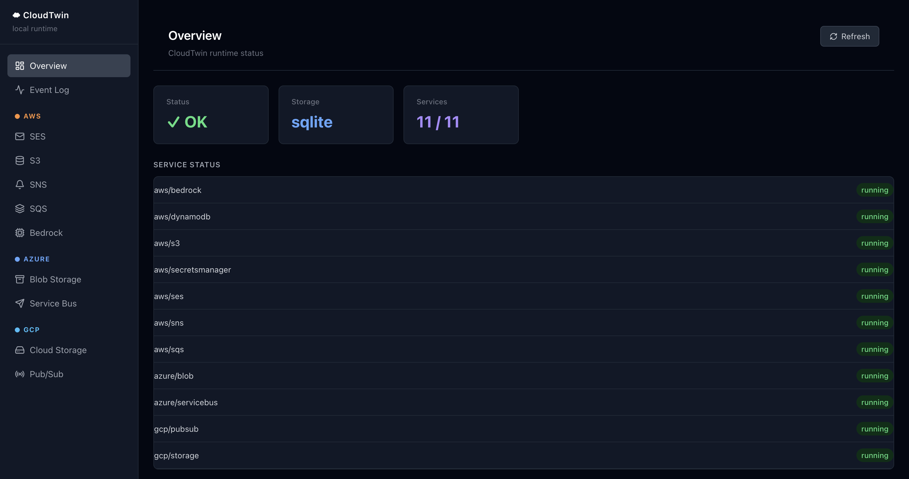
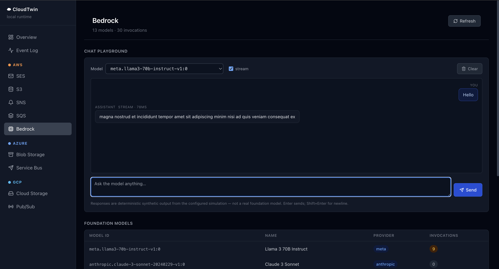
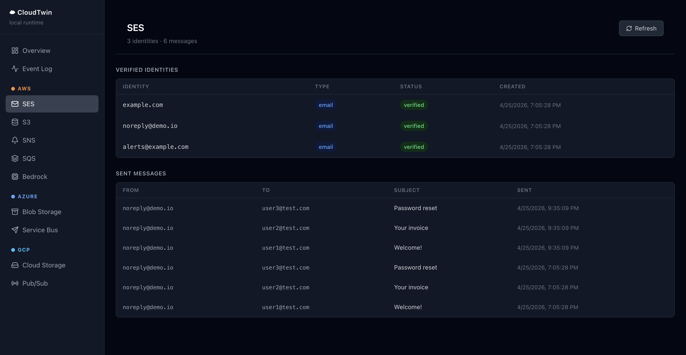
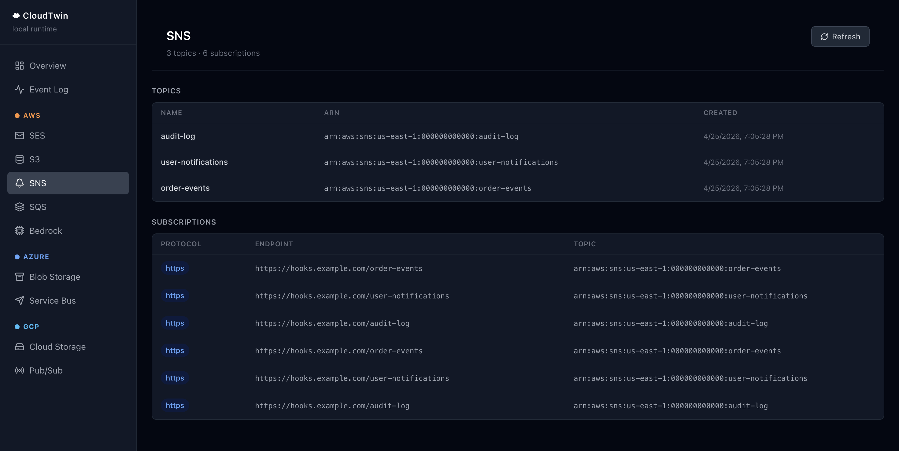

# CloudTwin

CloudTwin is a lightweight, self-contained local runtime for multi-cloud services.
It emulates AWS, Azure, and GCP service APIs in a single Rust binary with no
external dependencies — no MinIO, no RabbitMQ, no real cloud accounts required.

State is persisted in SQLite by default, or kept entirely in-memory for CI and
ephemeral test sessions. CloudTwin is designed to be a drop-in local replacement
for cloud services during development.

**Ports:** `4793` → cloud APIs and dashboard UI (`/dashboard`) · `1025` → SMTP (capture mailbox + SES receiving)



---

## Supported Services

| Provider | Service |
|---|---|
| AWS | SES (v1 + v2, including receiving) |
| AWS | S3 |
| AWS | SNS |
| AWS | SQS |
| AWS | DynamoDB |
| AWS | Secrets Manager |
| AWS | KMS |
| AWS | Cognito user pools (OIDC + hosted UI) |
| AWS | Bedrock (simulation) |
| Azure | Blob Storage |
| Azure | Service Bus |
| GCP | Cloud Storage |
| GCP | Pub/Sub |
| — | SMTP capture mailbox |

Highlights beyond basic CRUD:

| Area | What works |
|---|---|
| SES identities | DKIM tokens, `VerificationStatus`, controllable verification (`auto` / `manual` / `after_checks` / `delay`), custom MAIL FROM, `GetAccount`, AWS-typed errors (`NotFoundException`, `AlreadyExistsException`, ...) |
| SES sending | Simple and raw MIME, sender verification (`MessageRejected`), sandbox mode, configuration sets with SNS event destinations, mailbox simulator (`bounce@`, `complaint@`, ...), account suppression list |
| SES receiving | Receipt rule sets/rules; mail to the SMTP listener runs S3/SNS/AddHeader/Bounce/Stop actions |
| S3 | ListObjectsV2 paging/delimiters, metadata, tagging, copy, ranges, DeleteObjects, versioning, SSE headers, lifecycle/public-access-block configs, multipart upload, CORS, presigned POST, event notifications to SQS/SNS, virtual-hosted `{bucket}.s3.localhost` |
| SQS / SNS | Long polling, visibility timeouts, DLQ redrive, batch APIs, message attributes, FIFO; SNS delivery to SQS (envelope or raw), HTTP(S) and email, filter policies |
| KMS | Symmetric keys with real AES-GCM, aliases, data keys, encryption context |
| Cognito | Admin API, hosted login with Authorization Code + PKCE, RS256 tokens with Cognito claims, JWKS/discovery, refresh/revoke/logout |
| Testing | `POST /_cloudtwin/reset`, `POST /_cloudtwin/seed`, YAML `seed:` block for a reproducible local stack |

For the full list of supported operations per service, see
[docs/developer-guide.md](docs/developer-guide.md#supported-operations).

> **Upgrading from 0.3.x:** CloudTwin 0.4 is the former *CloudTwin Lite* Rust
> runtime; the Python backend has been retired (its source is preserved on the
> [`archive/python`](https://github.com/creocorp/cloud-twin/tree/archive/python)
> branch). Lambda, Azure Queue Storage / Event Grid / Key Vault / Functions,
> and GCP Firestore / Cloud Tasks / Secret Manager / Cloud Functions are not
> available yet. Database files written by the Python backend are not
> compatible — start with a fresh volume. Users of the `lite-*` image tags
> should switch to the regular tags (`latest`, `0.4`, ...); the default
> database file is now `/data/cloudtwin.db`.

---

## Running with Docker

```bash
docker pull creogroup/cloudtwin:latest
docker run -p 4793:4793 -p 1025:1025 creogroup/cloudtwin
```

To persist data across restarts, mount a volume at `/data`:

```bash
docker run -p 4793:4793 -p 1025:1025 -v cloudtwin-data:/data creogroup/cloudtwin
```

To use your own config file, mount it at `/config/cloudtwin.yml`:

```bash
docker run -p 4793:4793 -p 1025:1025 \
  -v cloudtwin-data:/data \
  -v $(pwd)/config/cloudtwin.yml:/config/cloudtwin.yml \
  creogroup/cloudtwin
```

---

## Running from Source

Requires a recent stable Rust toolchain.

```bash
git clone https://github.com/creocorp/cloud-twin.git
cd cloud-twin
make run                  # in-memory storage on http://localhost:4793
make run-with-dashboard   # SQLite in ./data + dashboard at /dashboard
make build                # release binary at target/release/cloudtwin
```

Point any SDK at `http://localhost:4793` with dummy credentials:

```python
import boto3
s3 = boto3.client("s3", endpoint_url="http://localhost:4793", region_name="us-east-1",
                  aws_access_key_id="test", aws_secret_access_key="test")
```

---

## Mailbox (email capture)

CloudTwin runs an SMTP sink on port `1025` that stores every inbound
message (headers, text/HTML bodies, attachments) in SQLite. Mail sent through
SES v1/v2 `SendEmail` and `SendRawEmail` is captured into the same inbox. When
an SES receipt rule set is active, recipients matched by its rules are handled
by the rules (e.g. written to S3) instead of the inbox.
Browse it at `http://localhost:4793/dashboard` → **Mailbox**, or via
`GET /api/dashboard/mailbox` and `GET /api/dashboard/mailbox/{id}`. It is a
capture-only sink: no TLS, no auth, and nothing is relayed.

```python
import smtplib
from email.message import EmailMessage

msg = EmailMessage()
msg["From"], msg["To"], msg["Subject"] = "app@example.com", "user@example.com", "Hi"
msg.set_content("Hello from my app")
with smtplib.SMTP("localhost", 1025) as smtp:
    smtp.send_message(msg)
```

---

## AWS Bedrock Simulation

CloudTwin includes a fully config-driven Bedrock simulation engine. It does
**not** call real models — it produces deterministic synthetic responses for
testing SDK integration, retry logic, streaming handling, and prompt routing.

All output is **deterministically seeded** from `(model_id, field_path, request_count)`.
The same call always produces the same result — critical for stable tests and
snapshot assertions.

### Endpoints

| Method | Path | SDK operation |
|---|---|---|
| `GET` | `/foundation-models` | `bedrock.list_foundation_models()` |
| `POST` | `/model/{modelId}/invoke` | `bedrock-runtime.invoke_model()` |
| `POST` | `/model/{modelId}/invoke-with-response-stream` | `bedrock-runtime.invoke_model_with_response_stream()` |

Responses include introspection headers:

| Header | Value |
|---|---|
| `x-cloudtwin-request-count` | Per-model invocation counter (1-based) |
| `x-cloudtwin-response-source` | How the response was resolved: `text`, `schema`, `static`, `rule`, `sequence[N]`, `error_injection` |

### Dashboard chat playground

The dashboard's **AWS → Bedrock** page includes an interactive chat window for
sending prompts to any configured model. It calls the live `/model/{id}/invoke`
and `/model/{id}/invoke-with-response-stream` endpoints, decodes the EventStream
binary frames in the browser, and shows the resolution source and request count
— useful for quickly probing scenario rules and streaming behaviour without
writing SDK code.

### Quick example

```python
import boto3, json

client = boto3.client(
    "bedrock-runtime",
    endpoint_url="http://localhost:4793",
    aws_access_key_id="test",
    aws_secret_access_key="test",
    region_name="us-east-1",
)

resp = client.invoke_model(
    modelId="anthropic.claude-3-sonnet-20240229-v1:0",
    body=json.dumps({"prompt": "Summarise this document"}).encode(),
    contentType="application/json",
    accept="application/json",
)
result = json.loads(resp["body"].read())
print(result["content"])  # synthetic lorem-ipsum text
```

### Resolution pipeline

When `invoke_model` or `invoke_model_with_response_stream` is called, the
engine resolves a response in strict priority order — **first match wins**:

1. **Error injection** — if the model has `errors:` configured and
   `request_count % every == 0`, return a synthetic AWS error immediately.
2. **Prompt rules** — scan `rules:` top-to-bottom; if any `contains:` substring
   matches the prompt (case-insensitive), return that rule's `response:` or
   `error:`.
3. **Sequence / cycle** — if the model has a `sequence:` block, select the
   response entry by request count (`sequence` clamps to last; `cycle` wraps).
4. **Fallback mode** — resolve using the model's `mode:` (`text`, `schema`, or
   `static`). If no mode is set, fall back to `defaults.mode` (default: `text`).

Unknown model IDs (not listed in `models:`) resolve using the global `defaults:`
— so the engine always returns a valid response, even for model IDs you haven't
configured.

### YAML configuration reference

The `bedrock:` section in `cloudtwin.yml` has two top-level keys:

```yaml
bedrock:
  defaults:             # fallback behaviour for unconfigured models
    mode: text          # text | schema | static
    latency:            # optional — applies to all models unless overridden
      min_ms: 50
      max_ms: 120

  models:
    <model_id>:         # every key appears in ListFoundationModels
      name: ...         # optional — derived from model_id if omitted
      provider: ...     # optional — derived from model_id prefix if omitted
      mode: text        # text | schema | static
      # ... per-feature config (see below)
```

---

#### Mode: `text` — synthetic lorem-ipsum

Returns a deterministic string of lorem-ipsum words seeded from the model ID
and request count.

```yaml
my-model.text:
  mode: text
  text:
    min_words: 10       # minimum words in response (default: 5)
    max_words: 30       # maximum words in response (default: 15)
```

Response body: `{ "content": "lorem ipsum dolor ...", "stop_reason": "end_turn", "model": "my-model.text" }`

---

#### Mode: `schema` — generated JSON matching a schema

Returns a JSON object with fake data generated recursively from a simplified
JSON Schema definition. Supported types: `object`, `array`, `string`, `number`,
`integer`, `boolean`. Arrays generate 1–3 items. `enum` selects cyclically.

```yaml
my-model.schema:
  mode: schema
  schema:
    type: object
    properties:
      summary:    { type: string }                     # → lorem-ipsum 2-word string
      confidence: { type: number }                     # → deterministic float (0.42, 0.73, …)
      tags:       { type: array, items: { type: string } }
      status:     { type: string, enum: [draft, published, archived] }  # cycles through values
      count:      { type: integer }                    # → deterministic int (1, 7, 42, …)
      active:     { type: boolean }                    # → alternates true/false
```

---

#### Mode: `static` — fixed payload

Returns the exact JSON object you configure, every time.

```yaml
my-model.static:
  mode: static
  static:
    result: fixed
    value: 42
```

---

#### Sequences and cycles

Define an ordered list of responses. In `sequence` mode the engine clamps to
the last entry once exhausted; in `cycle` mode it wraps around forever.

Each entry in `responses:` can be a `static:` payload, a `text:` config, or an
`error:`.

```yaml
# Sequence: first → second → second → second …
my-model.sequence:
  sequence:
    mode: sequence        # "sequence" (clamp) or "cycle" (wrap)
    responses:
      - static: { answer: first }
      - static: { answer: second }

# Cycle: a → b → a → b → a …
my-model.cycle:
  sequence:
    mode: cycle
    responses:
      - static: { answer: a }
      - static: { answer: b }

# Mixed entries: static, then text, then an error
my-model.mixed-seq:
  sequence:
    mode: sequence
    responses:
      - static: { step: "initial" }
      - text: { min_words: 3, max_words: 8 }
      - error: { type: ServiceUnavailableException, message: "Gone away" }
```

---

#### Prompt rules (`contains`)

Match on prompt content and return a specific response or error. Rules are
evaluated top-to-bottom; **first match wins**. If no rule matches, the engine
falls through to sequence/fallback.

```yaml
my-model.rules:
  mode: text                # fallback if no rule matches
  rules:
    - contains: sentiment
      response:
        static: { sentiment: positive, score: 0.9 }

    - contains: translate
      response:
        text: { min_words: 5, max_words: 10 }

    - contains: fail
      error:
        type: ValidationException
        message: "Prompt rejected by rule"
```

---

#### Error injection (`every: N`)

Fire a synthetic AWS error on every Nth invocation. Multiple entries are
supported — the first matching entry wins.

```yaml
my-model.flaky:
  mode: text
  errors:
    - every: 3
      type: ThrottlingException
      message: "Every 3rd request fails"
    - every: 10
      type: ServiceUnavailableException
      message: "Every 10th request is a 503"
```

---

#### Latency simulation

Add artificial delay before the response is sent. Configured per-model or
globally under `defaults:`. Per-model config overrides the global default.

```yaml
bedrock:
  defaults:
    latency:              # applies to all models unless overridden
      min_ms: 50
      max_ms: 200

  models:
    my-model.fast:
      mode: text
      latency:            # overrides the global default for this model
        min_ms: 0
        max_ms: 10
```

---

#### Streaming (`InvokeModelWithResponseStream`)

Control how the response is chunked into the AWS EventStream binary frames.
All chunk modes are supported.

```yaml
my-model.stream:
  mode: text
  streaming:
    enabled: true
    chunk_mode: word         # "word" | "char" | "fixed"
    fixed_chunk_size: 10     # bytes per chunk (only used when chunk_mode=fixed)
    first_chunk_delay_ms: 0  # delay before first chunk
    chunk_delay_ms: 20       # delay between subsequent chunks
    fail_after_chunks: 5     # inject a stream error after this many chunks (optional)
```

| `chunk_mode` | Behaviour |
|---|---|
| `word` (default) | Split on whitespace; each word is one event |
| `char` | Every character is a separate event |
| `fixed` | Fixed byte-width chunks of `fixed_chunk_size` |

Setting `fail_after_chunks` is useful for testing client-side stream error
recovery — the engine sends N valid chunks followed by a
`modelStreamErrorException` event.

---

#### Combining features

All features compose freely on a single model. The resolution pipeline applies
them in priority order, so you can have error injection + prompt rules +
sequence + streaming + latency all on the same model ID:

```yaml
my-model.kitchen-sink:
  mode: text
  text: { min_words: 10, max_words: 20 }
  latency: { min_ms: 50, max_ms: 150 }
  streaming:
    enabled: true
    chunk_mode: word
    chunk_delay_ms: 10
  errors:
    - every: 5
      type: ThrottlingException
      message: "Rate limited"
  rules:
    - contains: classify
      response: { static: { label: spam, confidence: 0.97 } }
  sequence:
    mode: cycle
    responses:
      - static: { answer: alpha }
      - static: { answer: beta }
```

On this model:
- Every 5th call → `ThrottlingException` (regardless of prompt)
- Prompt containing "classify" → `{ label: spam, confidence: 0.97 }`
- Otherwise → cycles between `alpha` and `beta`
- The `text:` fallback is only reached if `sequence:` is removed
- All successful responses are streamed word-by-word with 10ms inter-chunk delay
- A random 50–150ms latency is applied before any response

See [docs/developer-guide.md](docs/developer-guide.md#aws-bedrock-simulation) for additional architecture notes.

---

## Configuration

CloudTwin reads a YAML file at `CLOUDTWIN_CONFIG_PATH` (default
`/config/cloudtwin.yml`, optionally wrapped in a top-level `cloudtwin:` key).
Environment variables take precedence over YAML values.

| Variable | Default | Description |
|---|---|---|
| `CLOUDTWIN_CONFIG_PATH` | `/config/cloudtwin.yml` | Path to the YAML config file |
| `CLOUDTWIN_PORT` | `4793` | Port to listen on (overrides `api_port` in YAML) |
| `CLOUDTWIN_DB_PATH` | `/data/cloudtwin.db` | SQLite database path (`:memory:` for in-memory) |
| `CLOUDTWIN_MAILBOX_ENABLED` | `false` (`true` in the shipped `cloudtwin.yml`) | Start the SMTP capture mailbox (overrides `mailbox.enabled`) |
| `CLOUDTWIN_SMTP_PORT` | `1025` | Mailbox SMTP port (overrides `mailbox.smtp_port`) |
| `CLOUDTWIN_BASE_URL` | `http://localhost:{port}` | Public URL used in queue URLs, verification links, and the Cognito issuer |
| `CLOUDTWIN_SEED_PATH` | — | YAML/JSON seed document applied at startup (alternative to the `seed:` block) |
| `CLOUDTWIN_SES_STRICT_VERIFICATION` | `true` | Reject sends from unverified identities (`providers.aws.ses.strict_verification`) |
| `CLOUDTWIN_SES_VERIFICATION_MODE` | `auto` | `auto`, `manual`, `after_checks`, or `delay` (`providers.aws.ses.verification.mode`) |
| `CLOUDTWIN_SES_PRODUCTION_ACCESS` | `true` | `false` puts SES in sandbox mode |
| `CLOUDTWIN_S3_VIRTUAL_HOST_SUFFIX` | `s3.localhost` | Host suffix for virtual-hosted-style S3 (empty disables) |
| `CLOUDTWIN_COGNITO_SIGNING_KEY_PATH` | generated | RSA PEM used to sign Cognito tokens |

The full list of settings, the seed document format, and per-service details are
in [docs/developer-guide.md](docs/developer-guide.md#configuration).

### Storage

State lives in SQLite at `CLOUDTWIN_DB_PATH` (`storage.path` in YAML). Use
`:memory:` for ephemeral runs such as CI — nothing is written to disk.

### Test isolation

```bash
curl -X POST localhost:4793/_cloudtwin/reset                                  # everything
curl -X POST localhost:4793/_cloudtwin/reset -d '{"services": ["ses","sqs"]}'  # selected services
curl -X POST localhost:4793/_cloudtwin/seed  -d '{"s3": {"buckets": ["mail"]}}'
```

### Routing

| Provider | Base path |
|---|---|
| AWS (S3, SES, SNS, SQS, DynamoDB, Secrets Manager, KMS, Cognito) | `/` |
| Cognito OIDC / hosted UI | `/{userPoolId}/.well-known/*`, `/oauth2/*`, `/login`, `/logout` |
| CloudTwin test controls | `/_cloudtwin/*` |
| Azure (Blob Storage, Service Bus) | `/azure/` |
| GCP (Cloud Storage, Pub/Sub) | `/gcp/` |

For compatibility with SDK defaults, Azure Blob (`/{account}/...`), Service Bus
(`/{namespace}/queues|topics/...`), GCS (`/storage/v1/...`) and Pub/Sub
(`/v1/projects/...`) are also served at the root.

---

## Dashboard

The dashboard is served by the same process and port as the cloud APIs. The
Docker image enables it by default; open `http://localhost:4793/dashboard`.

The UI route and backing endpoints are:

- UI entry: `/dashboard`
- Static assets: `/dashboard/static/...`
- JSON API: `/api/dashboard/*`

The UI is mounted when `CLOUDTWIN_DASHBOARD_STATIC` (or `dashboard.static_path`
in `cloudtwin.yml`) points at the built assets in `dashboard/static`:

```bash
make run-with-dashboard
```

The dashboard provides:

- **Overview** — live service health and recent event counts
- **Per-service pages** — browse and inspect resources for each service
  (SES identities and messages, S3 buckets and objects, SNS topics, SQS queues,
   Bedrock foundation models with an interactive **chat playground**,
   Azure Blob containers, Azure Service Bus queues/topics, GCP Cloud Storage
   buckets, GCP Pub/Sub topics and subscriptions)
- **Event log** — filterable stream of all actions emitted by the telemetry engine

| Overview | Bedrock Chat Playground |
|---|---|
|  |  |

| SES — identities & sent messages | SNS — topics & subscriptions |
|---|---|
|  |  |

The dashboard auto-polls the `/api/dashboard/*` endpoints, which are always
available; the static-path setting only controls whether the browser UI is mounted.

---

## Testing

```bash
make test-unit            # cargo test — in-process tests for every module
make test-integration     # boto3 / Azure / GCP SDK suites against target/debug/cloudtwin
make lint                 # cargo fmt --check + clippy
```

The SDK suites in [`tests/`](tests/) start the debug binary on a free port with
in-memory storage. Set `CLOUDTWIN_TEST_URL=http://host:port` to run them against
an already-running server instead (for example a Docker container).

---

## Contributing

See [docs/developer-guide.md](docs/developer-guide.md) for architecture,
design patterns, and instructions for adding new services or providers.
